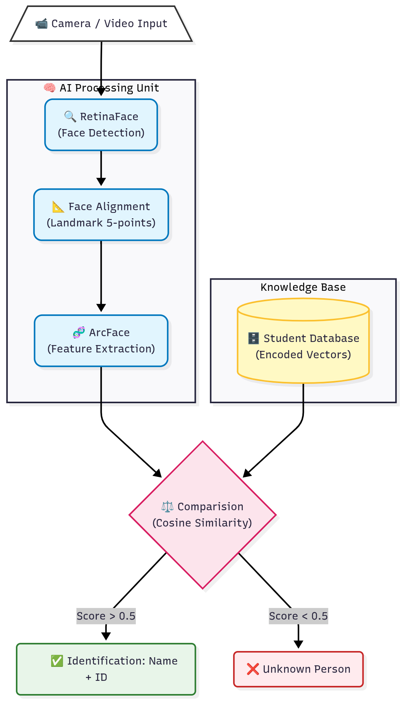

# Face Recognition Based Student Attendance System


A desktop application that takes class attendance from a webcam. A teacher opens a course, starts the camera, and every recognized student is marked present automatically. Students sign in to review their own attendance history.

## Features

- **Live recognition:** webcam frames are matched against stored face embeddings using InsightFace and cosine similarity.
- **Role-based UI:** separate teacher and student interfaces, each with its own login.
- **Attendance management:** per-course, per-date records with *Present*, *Absent* and *Not yet marked* states; teachers can override any status and add a note per student.
- **Student enrollment:** add a student and capture their face in one step; photos without a detectable face are rejected. The embedding cache is updated immediately, so no separate training stage is needed.
- **Excel import and export:** import a class roster (`.xlsx`, `.xls`, `.csv`) and export attendance reports to `.xlsx`.
- **Search and filter:** find students by name or ID and filter by attendance status.

## How It Works

1. **Detect:** InsightFace finds faces in each webcam frame.
2. **Embed:** each face is converted into a 512-dimensional embedding.
3. **Match:** the embedding is compared with the embeddings of the students enrolled in the selected course using cosine similarity.
4. **Record:** a match above `SIMILARITY_THRESHOLD` (default `0.5`) marks the student present with a timestamp.



## Tech Stack

| Area | Technology |
| :--- | :--- |
| Language | Python 3.10+ (tested on 3.12) |
| GUI | PyQt5 (Widgets + QSS stylesheets) |
| Face recognition | InsightFace (`buffalo_l` model pack), ONNX Runtime |
| Computer vision | OpenCV, NumPy |
| Persistence | SQLite via SQLAlchemy |
| Spreadsheets | pandas, openpyxl |

## Project Structure

```
.
├── app/
│   ├── ui/            # PyQt5 windows and dialogs (login, teacher, student, camera)
│   ├── controllers/   # Business logic between the UI and the database
│   ├── services/      # Face recognition: model, embedding cache, cosine matching
│   ├── database/      # SQLAlchemy engine, session factory and models
│   ├── config.py      # Paths and tunables (single source of truth)
│   └── constants.py   # Attendance status values
├── assets/            # Icons, images and QSS stylesheets
├── data/              # Runtime data: SQLite DB, embeddings, face photos (gitignored)
├── samples/           # Sample class roster for the Excel import
├── scripts/           # Utilities: seed_data, build_face_cache
├── docs/images/       # README screenshots
└── main.py            # Application entry point
```

## Getting Started

### Prerequisites

- Python 3.10 or newer
- A webcam
- Internet access on first run: InsightFace downloads the `buffalo_l` model (about 280 MB) to `~/.insightface`
- Optional: an NVIDIA GPU with `onnxruntime-gpu` installed. CUDA is used automatically when available; otherwise the CPU is used.

### Installation

```bash
git clone https://github.com/devk1ngz/Face-Recognition-Based-Student-Attendance-System.git
cd Face-Recognition-Based-Student-Attendance-System

python -m venv .venv
source .venv/bin/activate        # Windows: .venv\Scripts\activate

pip install -r requirements.txt
```

### Run

```bash
python main.py
```

The database is created on first launch. Register a teacher account from the login screen, or load demo data as described below.

### Demo data (optional)

```bash
python -m scripts.seed_data          # sample teachers, courses and students
python -m scripts.build_face_cache   # embeddings from data/raw_faces/<student_id>.jpg
```

Seeded logins (development only, passwords are stored in plain text):

| Role | Username | Password |
| :--- | :--- | :--- |
| Teacher | `admin`, `gv002` | `123` |
| Student | the student ID, e.g. `9900000001` | `123` |

Run the scripts from the repository root with `python -m`, not `python scripts/<name>.py`.

## Usage

1. **Sign in** as a teacher and pick a course in the sidebar.
2. **Add students** one by one with *Thêm sinh viên* (fill in the form and capture a photo), or import a roster with *Nhập file lớp* (see `samples/dsa_list.xlsx` for the layout). Students imported from Excel have no face yet: open *Thêm sinh viên* with their MSSV to capture it.
3. **Take attendance** with *Bắt đầu điểm danh*. Recognized students are marked present; change any status from the table, and double-click the *Ghi chú* cell to add a note.
4. **Export** the result with *Xuất Excel*.
5. **Students** sign in with their MSSV account to see their attendance history. The first sign-in links the account to the roster row with the same MSSV, so students imported from Excel can register on their own.

The interface text is in Vietnamese.

## Configuration

Everything tunable lives in [`app/config.py`](app/config.py):

| Setting | Default | Purpose |
| :--- | :--- | :--- |
| `SIMILARITY_THRESHOLD` | `0.5` | Minimum cosine similarity to accept a match |
| `CAMERA_INDEX` | `0` | Webcam device index |
| `FACE_MODEL_NAME` | `buffalo_l` | InsightFace model pack |
| `FACE_DET_SIZE` | `(640, 640)` | Detector input size |
| `DATA_DIR` | `<repo>/data` | Location of the database, photos and embedding cache |

## Data and Privacy

`data/` holds personal data (face photos, embeddings, the student database) and is excluded from version control. Do not commit it, and obtain consent before collecting face data from real students.

## Screenshots

| Teacher dashboard | Student dashboard |
| :---: | :---: |
|  |  |

| Attendance in progress |
| :---: |
|  |

## Known Limitations

- Passwords are stored and compared in plain text. Do not deploy this as is.
- `Student.mssv` is globally unique, so a student cannot be enrolled in more than one course.
- Only the first face detected in an enrollment photo is used.
- There is no automated test suite.

## License and Third-Party Terms

This repository does not currently grant an open-source license; all rights are reserved by the author. Two dependencies restrict how the project can be used and redistributed:

- **InsightFace models:** the InsightFace *code* is MIT-licensed, but the pretrained models, including the `buffalo_l` pack this project downloads at runtime, are available **for non-commercial research purposes only**. Commercial use requires a separate license from InsightFace ([terms](https://github.com/deepinsight/insightface#license)).
- **PyQt5:** distributed under GPL v3 or a commercial license from Riverbank Computing. Distributing this application together with PyQt5 must comply with the GPL v3, or use a commercial PyQt license.

Use this project for learning, coursework and research. Do not use it in a commercial or production setting without resolving both points above.

## Author

[Devk1ngz](https://github.com/devk1ngz)
